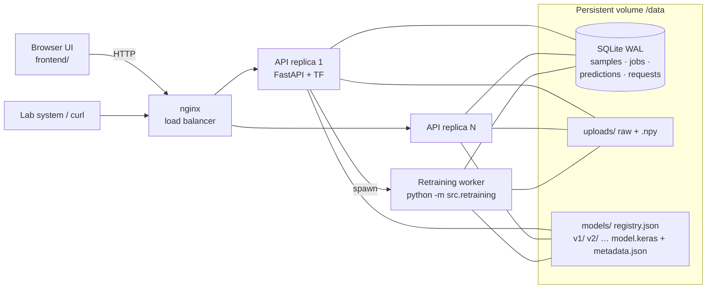
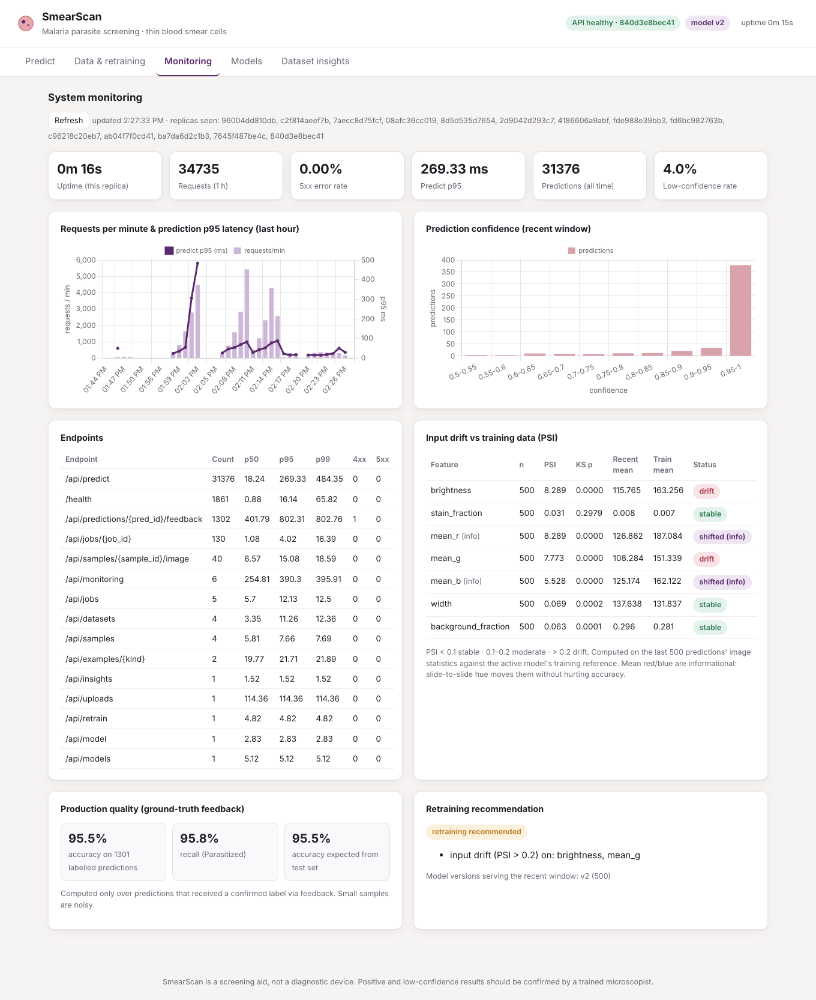
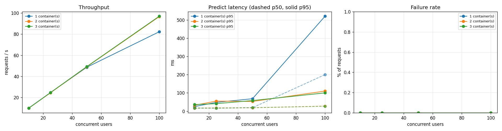

# SmearScan — malaria parasite screening with a retrainable ML service

SmearScan classifies single red-blood-cell images from Giemsa-stained thin blood smears as **Parasitized** or
**Uninfected**. It is a complete ML system: a reproducible data pipeline with a patient-level split, a transfer-learning
model evaluated against a custom CNN baseline, a FastAPI service with a web UI, bulk labelled-data ingestion, a real
retraining pipeline that fine-tunes the deployed model and only promotes it through an acceptance gate, model versioning
with rollback, production monitoring with drift detection, Docker images, and Locust scaling experiments.

| | |
|---|---|
| **Live app (UI + API)** | Not yet deployed — one command, see [Cloud deployment](#cloud-deployment). The same image is verified locally (§9–§11). |
| **API docs (OpenAPI)** | `<app URL>/docs` |
| **Demo video** | To be recorded against the deployed app — script in [`docs/video_script.md`](docs/video_script.md) |
| **Notebook** | [`notebook/malaria_cell_classification.ipynb`](notebook/malaria_cell_classification.ipynb) (executed, with outputs) |

---

## 1. Problem

Light microscopy of blood smears is the reference test for malaria across sub-Saharan Africa. In 2024 the WHO African
Region accounted for an estimated 94% of the world's 282 million malaria cases and 95% of its 610,000 deaths
([WHO World malaria report 2025](https://www.who.int/teams/global-malaria-programme/reports/world-malaria-report-2025)).
Reading a smear is slow, skilled work, and its accuracy depends on the microscopist's training and workload. A model that screens the individual cells on a digitised smear lets a
microscopist concentrate on the slides and cells that need attention.

The task here is the cell-level step of that workflow: given one segmented cell, predict whether it contains
*Plasmodium falciparum*. **Parasitized is the positive class.** A missed infection is costlier than an extra review,
so recall on Parasitized is a first-class metric and is protected by the retraining acceptance gate.

SmearScan is a screening aid, not a diagnostic device.

## 2. Data

| | |
|---|---|
| Dataset | NIH/NLM malaria cell images (thin smear, *P. falciparum*) |
| Origin | Chittagong Medical College Hospital, Bangladesh; annotated at the Mahidol-Oxford Tropical Medicine Research Unit; published by the U.S. National Library of Medicine (LHNCBC) |
| Citation | Rajaraman S. et al., *Pre-trained convolutional neural networks as feature extractors toward improved malaria parasite detection in thin blood smear images*, PeerJ 6:e4568, 2018 |
| Licence | U.S. Government work — public domain in the U.S.; attribution requested |
| Size | 27,556 unique PNG crops (13,778 per class), 201 patients |
| Canonical page | https://lhncbc.nlm.nih.gov/LHC-research/LHC-projects/image-processing/malaria-datasheet.html |

**Why this dataset.** Expert labels, balanced classes, permissive licence, small images that are realistic to serve on
CPU, and — the deciding factor — slide identifiers in the file names, which make an honest patient-level evaluation
possible. Many published results on this dataset split cells randomly, which puts the same patient's cells in train and
test and overstates accuracy.

**Acquisition and split** (`scripts/acquire_data.py`). Downloads (or reads) the images, verifies every file, removes
byte-identical duplicates, computes per-image descriptors, and assigns **whole patients** to train/val/test so that each
split holds 70/15/15% of each class's cells (searched over 3,000 seeded assignments; worst deviation 0.34 percentage
points). The script asserts zero patient overlap.

| split | Parasitized | Uninfected | patients |
|---|---:|---:|---:|
| train | 9,608 | 9,609 | 140 |
| val | 2,056 | 2,104 | 31 |
| test | 2,114 | 2,065 | 30 |

Outputs: `data/manifest.csv` (path, label, patient, split, SHA-256, image statistics), `data/dataset_card.json`,
`data/insights.json` (what the UI's insights tab renders).

### What the data shows

| Feature | Finding | Consequence for the system |
|---|---|---|
| **Purple chromatin (stain) fraction** | 62% of parasitized cells have >1% dark-purple pixels vs 0.9% of uninfected; this one hand-crafted feature has ROC-AUC 0.971 | The signal is small and colour-defined: keep RGB, use 128 px inputs. Errors and label noise concentrate where stain is absent on a parasitized cell or present on an uninfected one |
| **Brightness / slide effect** | Spread of per-slide mean brightness (sd 9.1) exceeds within-slide spread (sd 6.5) | Staining differs more between slides than between cells: patient-level split, brightness/contrast augmentation, brightness and stain drift monitoring in production |
| **Crop size** | 46–394 px wide (median 130), nearly identical across classes (ROC-AUC 0.53) | No size shortcut; aspect-preserving resize to 128 px with black padding |
| **Cells per patient** | 65–702 cells per patient; 50 patients uninfected-only; every infected patient also contributes uninfected cells | Patient grouping is essential; a random split would leak heavy slides into test |

Limitations: one hospital and one imaging setup; *P. falciparum* only; cells are pre-segmented (the model does not
locate cells on a full slide); known residual label noise in the public set.

## 3. Model development

All of this is in the notebook, which imports the same `src/` code the service runs.

- **Preprocessing** (`src/preprocessing.py`, shared by training, retraining and serving): decode + validate (format,
  corruption, size), RGB, aspect-preserving resize to 128 px on black, scale to [-1, 1]. Training augmentation: flips,
  90° rotations, mild brightness/contrast jitter.
- **Baseline**: custom 5-block CNN from scratch (251k params), Adam, ReduceLROnPlateau, early stopping.
- **Transfer model**: ImageNet MobileNetV2 (α=1.0, 128 px; 3.5 M backbone params, ~0.1 GFLOPs) — chosen for accuracy per
  FLOP on CPU-only serving. Head: GAP → dropout → dense(ReLU, L2) → dropout → sigmoid.
- **Optimisation**: head hyperparameters searched on cached backbone features (dropout {0.2, 0.4} × units {64, 128} ×
  Adam lr {1e-3, 3e-4} or SGD-Nesterov 1e-2; `docs/hparam_search.csv`), then two-stage training: frozen backbone, then
  blocks 13–16 unfrozen with cosine-decayed lr from 1e-4 (BatchNorm frozen), early stopping with best-weight restore,
  L2 + dropout regularisation.

### Results on held-out test patients (n = 4,179 cells, 30 patients)

| metric (Parasitized = positive) | MobileNetV2 transfer (deployed v1) | Custom CNN baseline |
|---|---:|---:|
| accuracy | 0.9579 | 0.9612 |
| loss (binary cross-entropy) | 0.1179 | 0.1131 |
| precision | 0.9681 | 0.9752 |
| recall (sensitivity) | 0.9480 | 0.9475 |
| specificity | 0.9680 | 0.9753 |
| F1 | 0.9579 | 0.9611 |
| ROC-AUC | 0.9913 | 0.9924 |
| PR-AUC | 0.9919 | 0.9929 |
| **accuracy under mild stain shift** | **0.9581** | 0.9368 |
| **accuracy under strong stain shift** | **0.9519** | 0.7523 |
| single-image CPU latency | 8.8 ms | 2.2 ms |
| parameters / training time (2 vCPU) | 2.34 M / 21 min | 0.25 M / 16 min |

Validation accuracy: transfer 0.9661, baseline 0.9596. Frozen-backbone heads from the search peaked at 0.938.

**Reading the results honestly.** On in-distribution test patients the two models are statistically
indistinguishable: the accuracy difference is −0.34 points with a 95% *patient-level* bootstrap interval of
[−1.2, +0.7]. What separates them is robustness. Under a simulated stain/illumination shift (darker, bluer slides — the
slide-level batch effect the EDA found), the baseline collapses to 75% accuracy because it calls almost every darker cell
parasitized (specificity 0.51), while the transfer model holds 95%. Since new clinics will bring new staining, that is
why the transfer model is the one deployed and retrained, at the cost of ~4× higher (still sub-10 ms) inference latency.

Errors cluster by patient (6 of 30 test patients have none; one slide has an 18% error rate). Missed infections are
cells with almost no visible stain; false positives carry stain specks — some look mislabelled, consistent with known
noise in this dataset. At threshold 0.5 the model misses 110 of 2,114 infected cells; at 0.3 it misses 75 with
specificity 0.947. The service keeps 0.5 and flags cells within 0.15 of it for microscopist review; the threshold is a
configuration value, not a retraining decision.

Figures (`docs/figures/`): sample cells, feature distributions, per-slide brightness, augmentation, training curves,
confusion matrices + ROC + precision–recall, and the most confident errors.

## 4. Architecture



- **Serving** (`src/prediction.py`): each replica loads the registry's active version and re-checks the registry file's
  mtime on each request, so promotions and rollbacks take effect on every replica without restarts.
- **Storage** (`src/data_store.py`): SQLite in WAL mode on the shared volume. High-frequency writes (request metrics,
  prediction logs) are batched by a background thread, so logging never adds latency to predictions.
- **Registry** (`src/registry.py`): immutable versions, atomic `registry.json` writes under a file lock, statuses
  `candidate / active / archived / rejected`, event log, promotion and rollback.
- **Retraining** runs in a separate OS process launched by the API (one job at a time, enforced by an atomic DB check);
  progress, per-epoch metrics and results are written to the jobs table that the UI polls.

**Web UI** (served by the API at `/`; screenshots are real captures from the UI end-to-end test against the Docker stack):

| | |
|---|---|
| [Predict](docs/screenshots/01_predict.png) — single-cell prediction, probability bar, recommendation, ground-truth feedback | [Dataset insights](docs/screenshots/02_insights.png) — four interpreted features with charts |
| [Upload](docs/screenshots/03_upload.png) — bulk labelled upload report and stored batches | [Retraining](docs/screenshots/05_retraining_result.png) — live stages, epoch curves, gate table, promotion |
| [Models](docs/screenshots/06_models.png) — active model, confusion matrix, version history, rollback | [Monitoring](docs/screenshots/07_monitoring.png) — traffic, latency, drift, labelled accuracy, retraining signal |

**Technology choices.** TensorFlow/Keras (mature CPU inference, single-file `.keras` artifacts); FastAPI (typed
validation, OpenAPI docs, async file handling); SQLite rather than a database server because the service runs on one
host and the data volumes are small — all SQL is portable to PostgreSQL if it needs to scale out across hosts; plain
HTML/JS + vendored Chart.js for the UI so the frontend is served by the API with no build step or CDN dependency;
nginx for load balancing; Docker for packaging; Locust for load generation.

## 5. Retraining workflow

1. **Upload** labelled data in the UI (*Data & retraining*) or `POST /api/uploads`: many images with one label, and/or a
   ZIP with `Parasitized/` and `Uninfected/` folders. Each file is validated (format, corruption, size), de-duplicated by
   SHA-256, stored raw under `storage/uploads/<batch>/`, preprocessed with the training function into a `.npy`, and
   recorded in `samples` with batch, label, image stats and status. Rejections are reported per file with the reason.
2. **Trigger** with the *Start retraining* button or `POST /api/retrain` (needs ≥ 20 unused samples).
3. **Train** (`src/retraining.py`): loads the **currently active model's saved weights** (v1 is the notebook's
   MobileNetV2), unfreezes blocks 13–16, and fine-tunes with Adam at 1e-5 on the new samples (80% stratified) mixed
   with **replayed original cells** (3× the new data, ≥ 600, from a fixed 3,000-cell pool spread over 140 training
   patients) to prevent forgetting. Early stopping watches new-data holdout + held-back replay cells.
4. **Gate**: candidate and active model are scored on the **gold test set** (all held-out-patient test cells). Promote
   only if F1 drops ≤ 0.005, Parasitized recall drops ≤ 0.01, and new-holdout accuracy drops ≤ 0.01.
5. **Register**: the candidate is saved as a new version with lineage (parent version, sample ids, upload batches),
   hyperparameters, metrics for both models and the gate decision — promoted, or kept as `rejected` while the old model
   keeps serving. Used samples are marked with the version that consumed them.
6. **Rollback**: *Models* tab → *Roll back*, or `POST /api/models/rollback`; any archived version can be re-activated.

**Measured run (deployed Docker stack, driven through the web UI).** 40 labelled cells from validation-split patients
(`demo_upload/demo_batch.zip`) were uploaded and the *Start retraining* button pressed. The worker fine-tuned v1 on
32 new + 600 replayed cells; early stopping kept epoch 1 of 3; total 95 s on one CPU. Gold-set results (4,179 cells):

| | accuracy | precision | recall | F1 | ROC-AUC |
|---|---:|---:|---:|---:|---:|
| v1 (parent) | 0.9579 | 0.9681 | 0.9480 | 0.9579 | 0.9913 |
| v2 (candidate) | 0.9545 | 0.9500 | 0.9607 | 0.9553 | 0.9918 |

F1 fell 0.0026 (within the 0.005 tolerance) and recall rose 1.3 points, so v2 was promoted; every replica switched to it
without restart, and v1 stayed available for rollback. In an earlier container test with an under-trained model, the
gate **rejected** a candidate whose F1 fell 0.011 and the parent kept serving. Screenshots: `docs/screenshots/03`–`06`.

40 cells is a demonstration-sized batch: the trade it produced (more sensitivity, slightly less precision) is within
noise, which is exactly the case the gate is designed to tolerate.

## 6. Monitoring and production evaluation

`GET /api/monitoring` (and the *Monitoring* tab) reports:

- uptime, request volume per minute, p50/p95/p99 latency and 4xx/5xx counts per endpoint, requests per replica;
- prediction volume, class mix, confidence histogram, low-confidence (referral) rate, model versions serving traffic;
- **input drift**: for brightness, stain fraction, mean R/G/B, crop width and background share, PSI (and KS p-value)
  of the last 500 predictions against decile bins of the active model's training data (stored in its metadata);
- **production quality only where ground truth exists**: `POST /api/predictions/{id}/feedback` attaches a confirmed
  label (e.g. from a microscopist's read or a lab information system). Accuracy, precision and recall are computed over
  labelled predictions only; with no feedback the UI says so instead of estimating;
- a **retraining recommendation** when drift exceeds PSI 0.2 on any feature, labelled accuracy falls > 3 points below
  the model's test accuracy (≥ 30 labels), or enough new labelled uploads are waiting.

**Collecting ground truth in practice.** Route a sample of predictions — every low-confidence result plus a random 5%
of the rest — to microscopist review, post their reads as feedback, and add the confirmed cells to the training pool.

**Measured drift experiment** (`scripts/simulate_drift.py`, 3-replica stack, 500 predictions per phase so the
500-prediction window holds only that phase's traffic, with true labels posted as feedback):

| feature | phase 1: held-out test cells (PSI) | phase 2: darker, blue-shifted cells (PSI) |
|---|---:|---:|
| brightness | 0.092 | **8.29** |
| stain fraction | 0.013 | 0.031 |
| mean green | 0.025 | **7.77** |
| crop width | 0.071 | 0.069 |
| background share | 0.112 | 0.063 |
| mean red / mean blue (informational) | 0.57 / 0.41 | 8.29 / 5.53 |
| **retraining signal** | none | **recommended: drift on brightness, mean green** |
| accuracy on that traffic (from feedback) | 95.0% | 95.8% |

Calibrating the detector mattered. Mean red and blue already show PSI ≈ 0.4–0.5 on clean held-out patients (slide hue
varies) while accuracy there is 95.8%, so they are reported but do not alert; the five alerting features stay below
0.13 on random 500-cell windows of held-out data. The shifted stain is caught immediately. The model's labelled accuracy
held up under this particular shift (the transfer model's robustness from §3), so the signal means *collect labels and
check*, not *the model is broken*; the labelled-accuracy rule is what would confirm real degradation. Windows drawn from
only a few slides (e.g. one clinic-day) vary much more, so alerts should be read against the patient mix, and a
per-site reference is the natural next step once sites contribute labelled data.

Feedback calls can land on a different replica than the prediction they label, while that replica's log batch has not
been flushed yet; the feedback endpoint waits up to ~2.5 s for the row, which shows up as a ~0.4 s median on that
endpoint and keeps the prediction path free of synchronous database writes.



## 7. API

Interactive docs at `/docs`. All endpoints return JSON.

| Method | Path | Purpose |
|---|---|---|
| GET | `/health` | liveness, uptime, replica, served model version |
| GET | `/ready` | readiness (model loaded, DB reachable) |
| GET | `/api/model` | active model: architecture, hyperparameters, data lineage, metrics |
| GET | `/api/models`, `/api/models/{v}` | registry versions, statuses, events; one version's metadata |
| POST | `/api/models/{v}/activate`, `/api/models/rollback` | manual promotion / rollback |
| POST | `/api/predict` | single image (`file`) → class, confidence, probabilities, low-confidence flag, recommendation, image stats, latency, `prediction_id` |
| POST | `/api/predictions/{id}/feedback` | `{"true_label": "Parasitized"}` ground truth for a prediction |
| GET | `/api/predictions` | recent predictions |
| POST | `/api/uploads` | bulk labelled upload: `files[]` + `label`, and/or `archive` (ZIP with class folders), optional `note` |
| GET | `/api/datasets`, `/api/samples`, `/api/samples/{id}/image` | stored data summary, batches, samples, images |
| POST | `/api/retrain` | start retraining (`{"epochs": 4, "learning_rate": 1e-5}` optional) → `job_id` |
| GET | `/api/jobs`, `/api/jobs/{id}` | job status, stage, progress, per-epoch metrics, log, result + gate |
| GET | `/api/monitoring` | system, traffic, prediction, drift, quality, retraining signal |
| GET | `/api/insights` | dataset insights for the UI |
| GET | `/api/examples/{parasitized\|uninfected}` | a known-label held-out test image (demos, smoke tests) |

```bash
curl -F "file=@data/test/Parasitized/C39P4thinF_original_IMG_20150622_105253_cell_102.png" $URL/api/predict
curl -F "label=Uninfected" -F "files=@a.png" -F "files=@b.png" $URL/api/uploads
curl -F "archive=@demo_upload/demo_batch.zip" $URL/api/uploads
curl -X POST -H "Content-Type: application/json" -d '{}' $URL/api/retrain
```

## 8. Repository layout

```
README.md
notebook/malaria_cell_classification.ipynb   EDA, preprocessing, baseline, transfer learning, evaluation (executed)
src/
  config.py          settings from SMEAR_* environment variables
  preprocessing.py   validation, image contract, image statistics, augmentation
  model.py           architectures, data pipeline, training, metrics
  prediction.py      serving Predictor with registry hot-reload
  registry.py        versioned model registry (promotion, rollback)
  data_store.py      SQLite storage + batched async writer
  ingestion.py       bulk upload validation, de-dup, persistence, preprocessing
  retraining.py      retraining worker with replay and acceptance gate
  drift.py           PSI / KS drift detection
  monitoring.py      traffic, quality and retraining-signal aggregation
  train.py           non-interactive training pipeline (python -m src.train)
api/                 FastAPI app (main.py) and request schemas
frontend/            web UI (HTML/CSS/JS, vendored Chart.js)
data/
  manifest.csv, dataset_card.json, insights.json, replay_pool.csv
  train/             replay-pool images only in git (full set: scripts/acquire_data.py)
  test/              held-out-patient test images (gold evaluation set)
models/
  registry.json, v1/model.keras + metadata.json, baseline_cnn.keras, pretrained/ (ImageNet MobileNetV2 weights)
scripts/             data acquisition, insights, replay pool, notebook builder, deploy, drift simulation, entrypoint
tests/               pytest suite (preprocessing, model, registry, API, upload→retrain workflow, gate); ui/ui_e2e.js browser test
locust/              locustfile, experiment runner, summariser, measured results
deploy/              nginx load balancer, Hugging Face Space and Render configs
docs/                figures, UI screenshots, hyperparameter search, video script
demo_upload/         demo_batch.zip: 40 labelled validation-split cells for the upload/retraining demo
Dockerfile, docker-compose.yml, requirements*.txt, .env.example
```

## 9. Running it

### Local (Python 3.12)

```bash
python -m venv .venv && source .venv/bin/activate
pip install -r requirements-dev.txt
uvicorn api.main:app --port 8000          # UI at http://localhost:8000, docs at /docs
pytest -q                                  # full suite incl. a real retraining run (~2-4 min on CPU)
```

The repository ships the trained model, the gold test set and the replay pool, so the service and tests run from a
clean clone. To rebuild everything from the raw data:

```bash
python scripts/acquire_data.py --git-mirror https://github.com/TheODDYSEY/Malaria-Detection-Model   # or --source <cell_images/>
python scripts/build_insights.py && python scripts/make_replay_pool.py
curl -L -o models/pretrained/mobilenet_v2_1.0_128_no_top.h5 \
  https://github.com/JonathanCMitchell/mobilenet_v2_keras/releases/download/v1.1/mobilenet_v2_weights_tf_dim_ordering_tf_kernels_1.0_128_no_top.h5
# sha256 31150c34687a0e3f78a2bd0a8009ac321b966d10f3b184be4ff34c752f9dbe7f
jupyter nbconvert --to notebook --execute --inplace notebook/malaria_cell_classification.ipynb   # ~50 min on 2 CPU cores
# or, without the exploration: python -m src.train
```

### Configuration

Everything is set through `SMEAR_*` environment variables (see `.env.example` and `src/config.py`): paths, image size,
decision threshold, upload limits, retraining hyperparameters, gate tolerances, drift alert level. No secrets are needed
by the app; deployment tokens (e.g. `HF_TOKEN`) are read from the environment by the deploy script only.

### Docker

```bash
docker build -t smearscan .
docker run -p 8000:8000 -v smearscan-data:/data smearscan          # single container
docker compose up -d --build                                          # nginx + 1 replica on :8080
docker compose up -d --scale api=3 && docker compose up -d --force-recreate lb   # 3 replicas
```

The image holds the code, model v1, the gold test set and the replay pool (the build prunes everything else). On first
start the entrypoint seeds `/data/models` from the image; after that the volume is authoritative, so retrained versions
and uploads survive restarts and redeploys. Health check: `GET /health`; limits per replica: 1 CPU, 2 GB.

`BASE_IMAGE` can be overridden (`--build-arg BASE_IMAGE=...`) for environments that can't pull `python:3.12-slim`.

### Cloud deployment

**Target: Hugging Face Spaces (Docker).** The free CPU tier has 2 vCPU and 16 GB RAM, which is enough to run real
retraining inside the service (512 MB tiers are not: TensorFlow serving plus a training process needs ~1.5–2 GB).

```bash
pip install huggingface_hub==0.26.5
export HF_TOKEN=hf_...                       # write token; never committed
python scripts/deploy_hf.py --space <hf-username>/smearscan
# -> https://<hf-username>-smearscan.hf.space  (UI at /, API docs at /docs)
```

The script stages exactly the Docker build context (code, model registry, gold test set, replay-pool images) and
uploads it through the Hub HTTP API, so no git-lfs setup is needed. The Space builds the same `Dockerfile` with the
default `python:3.12-slim` base. Health check: `GET /ready`.

**Persistence.** Uploads, the SQLite database, retrained model versions and job logs all live under `/data`. On a free
Space the container disk resets when the Space restarts or rebuilds, so uploaded data and retrained versions would be
lost — and the entrypoint would re-seed v1. For durable storage enable the Space's *Persistent storage* (mounted at
`/data`, paid add-on); nothing in the code changes.

**Alternative: Render** (`deploy/render/render.yaml`): Docker web service with a persistent disk at `/data`. Persistent
disks require a paid instance, and the `standard` plan (2 GB) is the smallest that runs retraining.

**Scaling beyond one host.** Replicas share one volume here. Across hosts, swap SQLite for PostgreSQL (one module),
put uploads and model artifacts in object storage, and run the retraining worker as a separate job/queue consumer.

**Deployment status.** This repository was built and verified in an environment without cloud credentials, so the
public deployment is the one remaining manual step. Everything that runs in the cloud has been run here: the exact
image, single-container and nginx + 1–3 replica setups, health checks, volume seeding, upload persistence and
retraining inside the container, and the UI against the containerised API.

## 10. Load testing

**Setup (measured, not projected).** One 2-vCPU / 8 GB Linux VM ran everything: the nginx load balancer, 1–3 API
containers (each limited to 1 CPU and 2 GB, one uvicorn worker, model v2 — MobileNetV2), and Locust itself. Every run
lasted 60 s after a 20-request warm-up and used the same payloads: each simulated user cycles through the same 50
held-out test images (25 per class) and waits 0.5–1.5 s between requests (≈1 request/s per user), sending 95%
predictions and 5% health checks. Container CPU and memory were sampled with `docker stats` every 3 s.

```bash
locust/run_experiments.sh                                  # REPLICAS="1 2 3" USERS="10 25 50 100" DURATION=60s by default
python locust/summarise.py                                 # -> locust/results/summary.csv, scaling.png
locust -f locust/locustfile.py --host http://localhost:8080   # interactive web UI on :8089
```

| containers | users | requests | failures | throughput (req/s) | predict avg (ms) | p50 | p95 | p99 | CPU per container | memory per container (MiB) |
|---:|---:|---:|---:|---:|---:|---:|---:|---:|---:|---:|
| 1 | 10 | 595 | 0 | 10.1 | 18 | 16 | 25 | 72 | 11% | 301 |
| 1 | 25 | 1,459 | 0 | 24.7 | 23 | 17 | 48 | 160 | 34% | 301 |
| 1 | 50 | 2,876 | 0 | 48.7 | 32 | 19 | 68 | 470 | 59% | 314 |
| 1 | 100 | 4,858 | 0 | 82.3 | 232 | 200 | 520 | 1000 | 95% | 342 |
| 2 | 10 | 587 | 0 | 9.9 | 19 | 17 | 32 | 65 | 6% | 325 |
| 2 | 25 | 1,447 | 0 | 24.5 | 22 | 18 | 55 | 120 | 17% | 323 |
| 2 | 50 | 2,898 | 0 | 49.1 | 25 | 18 | 53 | 220 | 30% | 326 |
| 2 | 100 | 5,708 | 0 | 96.6 | 45 | 28 | 110 | 490 | 57% | 331 |
| 3 | 10 | 588 | 0 | 10.0 | 20 | 17 | 36 | 63 | 5% | 319 |
| 3 | 25 | 1,458 | 0 | 24.7 | 20 | 16 | 41 | 130 | 11% | 321 |
| 3 | 50 | 2,909 | 0 | 49.3 | 27 | 19 | 58 | 210 | 22% | 320 |
| 3 | 100 | 5,731 | 0 | 97.0 | 45 | 27 | 100 | 580 | 40% | 324 |



**Interpretation.**

- **No failures in any configuration** (31,114 requests in total).
- **Up to 50 users every configuration keeps up** with the offered load (~1 req/s per user). Median latency stays
  around 16–19 ms whatever the container count, because one MobileNetV2 inference takes ~9 ms and the rest is HTTP,
  multipart parsing and preprocessing. Extra containers only shave the tail (p99 at 50 users: 470 ms with one
  container, 210–220 ms with two or three) by spreading request bursts.
- **One container saturates at 100 users.** Its CPU is pinned at 95% of its 1-core limit, throughput plateaus at
  82 req/s against ~97 offered, and queueing pushes the median to 200 ms and p95 to 520 ms. This is the single-container
  capacity on this hardware: roughly 80–85 predictions/s per CPU core.
- **Two containers restore headroom.** They serve the full 97 req/s at a 28 ms median and 110 ms p95, each at ~57% CPU.
  Throughput scales with containers until the offered load is met, and latency falls because each replica's queue is
  shorter.
- **Three containers add nothing here**, and that is expected: the VM has only 2 vCPUs, shared with Locust and nginx,
  so a third replica cannot add compute; per-container CPU drops (40%) but totals stay the same. On a host with more
  cores, the 100-user and higher points would keep improving with the third container. Memory is flat at ~300–340 MiB
  per container, so memory does not limit scaling.
- **Caveat.** Locust shared the CPUs with the system under test, which slightly understates capacity. On the cloud
  target (one container, 2 vCPU) the measured single-container numbers are the relevant ones.

## 11. Tests

`pytest -q` — 31 tests, ~35 s on 2 vCPU, all passing. They run against an isolated copy of the real model registry and
real held-out images:

| file | covers |
|---|---|
| `test_preprocessing.py` | output contract (shape, dtype, range), aspect-preserving padding, upscaling, grayscale/JPEG conversion, rejection of empty / non-image / truncated / tiny / oversized / GIF files, stain feature on real cells |
| `test_model_registry.py` | active model loads with metadata; **predictions match the true labels of known held-out images**; probabilities sum to 1; registry versioning, immutability, promotion, rollback, protected active version; metric computation |
| `test_api.py` | health, readiness, model info, UI served; prediction correctness through HTTP; bad-input 422s; feedback + monitoring; upload validation (missing/unknown label, corrupted file, content-hash duplicates, bad ZIP); **full workflow: ZIP + labelled-file upload → persistence on disk and DB → retraining in a separate process → new version with lineage → promotion with hot reload (or rejection) → rollback**; one-job-at-a-time |
| `test_retraining_gate.py` | acceptance rules: pass, recall drop, F1 drop, small-holdout rule |

UI end-to-end: `tests/ui/ui_e2e.js` (Puppeteer) drives the real UI against a running stack — two example predictions
checked against their labels, feedback, insights, ZIP upload, the retraining button through to the result, models and
monitoring — and fails on any browser console error. The screenshots in `docs/screenshots/` are its output.

## 12. Limitations and next steps

- **Data**: one hospital, one imaging setup, *P. falciparum* only, pre-segmented cells. Before any clinical use the model
  needs prospective evaluation on slides from the clinics that would use it; the upload, feedback and gated-retraining
  loop exists for that.
- **Evaluation**: 30 test patients, so patient-level estimates are noisy (hence the bootstrap interval); the stain
  shift is synthetic.
- **Scope**: classifies single cells; slide-level diagnosis would add cell detection and parasitaemia counting.
- **Infrastructure**: SQLite + a shared volume fits one host; multi-host needs PostgreSQL and object storage. The
  retraining worker runs in the API container — fine for occasional jobs, but a queue-backed worker service is the next
  step. No authentication: upload, retrain and rollback endpoints must sit behind auth before a real deployment.
- **Load tests** were run on a 2-vCPU sandbox with Locust on the same machine (see §10).
